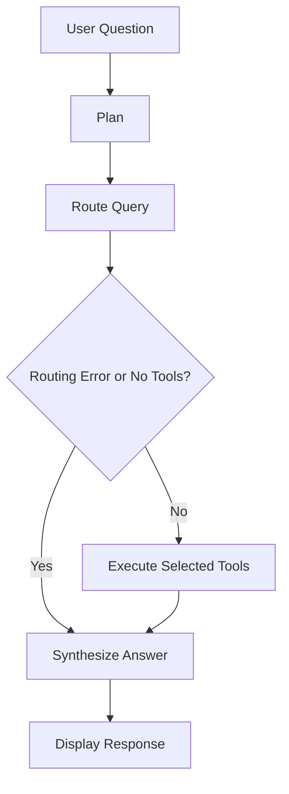

# Insight Copilot

Insight Copilot is a Streamlit app I built to explore the Brazilian E-Commerce (Olist) dataset. It lets users ask questions about product and category sales, monthly order trends, and delivery performance.

I used Pandas for data analysis and LangGraph to manage the workflow. The app uses predefined keyword rules to decide which tool to run, so it doesn't require an LLM or an API key.

**Live App:** https://insight-copilot-hytpdjwg8pw8ktepjgzyhr.streamlit.app/

## What it can do

- Find the top products and categories by item sales value.
- Show monthly order counts for a given date range.
- Calculate average delivery time and late-delivery percentage.
- Show which tools were selected and how a query was handled.
- Handle unsupported questions and tool errors without running unrelated tools.

## How it works

When a user enters a question, the app creates a plan and checks which tool can handle it. LangGraph manages the workflow, from planning and routing to tool execution and generating the final answer.

The app has three tools:

- **Data tool:** Finds top products or categories based on item sales value.
- **Trend tool:** Counts distinct orders by purchase month.
- **Delivery tool:** Calculates average delivery time and late-delivery percentage.

The router uses keyword-based rules to select the relevant tool. If it can't recognize a supported question, it skips tool execution and returns a message. When multiple tools are selected, a failure in one tool doesn't prevent successful results from the others from being used.

The **Plan & execution trace** section in the app shows the plan, selected tools, and routing details.

### Architecture



## Understanding the metrics

A few details are important when interpreting the results:

- **Item sales value:** The sum of order-item prices, excluding freight. This is not profit.
- **Monthly orders:** The number of distinct order IDs grouped by purchase month. All order statuses are included.
- **Average delivery time:** The average time between purchase and actual delivery for delivered orders with valid timestamps.
- **Late-delivery percentage:** The percentage of eligible delivered orders whose actual delivery was later than the estimated delivery date. Undelivered orders aren't counted as late.

## Example questions

- What are the top five product categories by item sales?
- Which products have the highest item sales?
- Show monthly order trends from 2017-01 to 2017-03.
- What was the late-delivery percentage?
- Compare monthly order trends from 2017-01 to 2017-03 and delivery performance.

The router recognizes specific query patterns, so some differently worded or ambiguous questions may not be supported.

## Tech stack

- Python 3.11
- Streamlit
- LangGraph
- Pandas
- `unittest`

## Project structure

```text
Insight-Copilot/
├── agent/
│   ├── graph.py
│   ├── nodes.py
│   ├── router.py
│   └── state.py
├── data/
│   └── olist/
├── scripts/
│   └── inspect_data.py
├── tests/
├── tools/
│   ├── data_tool.py
│   ├── trend_tool.py
│   └── delivery_tool.py
├── app.py
├── requirements.txt
└── README.md
```

## Running locally

### 1. Clone the repository

```bash
git clone https://github.com/shagunsrivastavaa/Insight-Copilot.git
cd Insight-Copilot
```

### 2. Create and activate the environment

```bash
conda create -n insight-copilot python=3.11 -y
conda activate insight-copilot
```

### 3. Install the dependencies

```bash
python -m pip install -r requirements.txt
```

### 4. Start the app

```bash
streamlit run app.py
```

Streamlit will display a local URL where you can open the app in your browser.

### Dataset

The app uses four CSV files stored in `data/olist/`:

- `olist_orders_dataset.csv`
- `olist_order_items_dataset.csv`
- `olist_products_dataset.csv`
- `product_category_name_translation.csv`

These files are included in the repository.

## Tests

To run the tests, use:

```bash
python -m unittest discover -s tests -v
```

The project has 17 unit tests covering routing, date validation, tool execution, error handling, and answer synthesis. All 17 tests passed in my local run.

## Limitations and what I'd improve

The app currently relies on keyword-based routing, so it can't understand every possible way a question might be phrased. It also doesn't carry conversational context from one question into the next graph run.

If I continued working on it, I'd improve follow-up question handling, support more query patterns, and add features such as anomaly detection and more detailed comparisons between trends and delivery performance.
