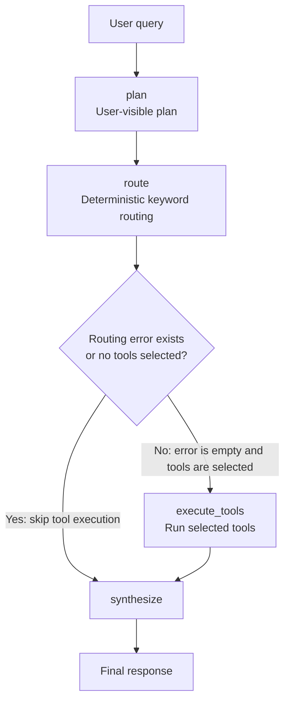

# Insight Copilot

Insight Copilot is a Streamlit chat app for asking supported questions about the Olist e-commerce dataset. A LangGraph workflow creates a short plan, routes the question with deterministic keyword rules, runs the relevant Pandas analysis tool or tools, and synthesizes a user-facing answer. The current implementation does not use an LLM or external API.

## Capabilities

- Rank products or product categories by order-item sales value.
- Count distinct orders by purchase month, optionally limited to an inclusive month range.
- Calculate delivery duration and late-delivery performance.
- Show a plan, routing explanation, selected tools, structured tool results, and errors in the Streamlit conversation.
- Keep chat messages in the active Streamlit session; history is not persisted between sessions.

## Architecture and workflow

`app.py` accepts a chat question and calls `run_query(query)` from `agent/graph.py`. The compiled LangGraph uses `InsightCopilotState` from `agent/state.py` to pass data between nodes:



1. **`plan` (`plan_node`)** creates a brief, user-visible plan. It does not select or execute tools.
2. **`route` (`route_node`)** calls `route_query` in `agent/router.py`. Case-insensitive keyword and pattern rules select the supported tool names and arguments, and add concise routing explanations.
3. **Conditional execution** checks the routing state. If `error` is non-empty or no tools were selected, the graph skips `execute_tools` and goes directly to `synthesize`. Otherwise, it runs `execute_tools`.
4. **`execute_tools` (`execute_tools_node`)** invokes only the selected tool functions and stores each structured result in `tool_results`. If a tool fails, its error is stored while successful results from other selected tools are retained.
5. **`synthesize` (`synthesize_node`)** deterministically formats the tool results as an analyst-style answer. It reports routing errors, partial failures, and the applicable metric definitions; it does not call an LLM.

The graph then reaches `END`. `run_query` accepts a non-empty string and returns the graph's resulting state dictionary.

## Analysis tools

All tool data paths are resolved relative to the project root, under `data/olist/`.

### Product and category rankings

Module: `tools/data_tool.py`  
Function: `query_data(operation: str, top_n: int = 10) -> dict`

- `operation` must be `"top_categories"` or `"top_products"`; `top_n` must be a positive integer. The router supplies `top_n=5` and chooses the operation from the question.
- Joins order items to products on `product_id`, then joins English translations on `product_category_name`. Left joins retain items without a matching product or translation.
- Returns `operation`, `metric`, and `records`. Category records contain `category` and `item_sales_value`; product records contain `product_id`, `category`, and `item_sales_value`.
- **Item sales value** is the sum of order-item `price`. `freight_value` is excluded. This is not profit or net revenue. Missing categories are labeled `Uncategorized`; missing product IDs use `unknown_product`.

### Monthly order trends

Module: `tools/trend_tool.py`  
Function: `query_monthly_orders(start_month: Optional[str] = None, end_month: Optional[str] = None) -> dict`

- Optional bounds use `YYYY-MM` format and are inclusive. For explicit numeric year-month ranges such as `from 2017-1 to 2017-03`, the router rejects malformed month tokens and reversed ranges before tool execution. The tool itself also validates its arguments.
- Returns `operation`, `metric`, and `records`, where each record has `month` and `order_count`.
- Counts distinct `order_id` values by calendar month of `order_purchase_timestamp`. All statuses are included, including canceled and unavailable. Rows with missing order IDs or invalid/missing purchase timestamps are omitted. Months without rows are not added with zero counts.

### Delivery performance

Module: `tools/delivery_tool.py`  
Function: `query_delivery_performance() -> dict`

- Takes no arguments and returns `operation`, `metric_definitions`, and `results`.
- `total_distinct_orders` counts non-missing order IDs across all statuses.
- `average_delivery_duration_days` is the mean elapsed time from purchase to actual customer delivery. Its denominator is delivered orders with valid purchase and delivery timestamps.
- `late_delivery_percentage` is late delivered orders divided by delivered orders with valid actual and estimated delivery timestamps. Delivery is late only when the actual timestamp is strictly after the estimate; arriving on the estimated date is on time. Undelivered orders are not classified as late.

## Dataset files

Place the Olist CSVs in `data/olist/`. The expected set is:

```text
data/olist/olist_customers_dataset.csv
data/olist/olist_geolocation_dataset.csv
data/olist/olist_order_items_dataset.csv
data/olist/olist_order_payments_dataset.csv
data/olist/olist_order_reviews_dataset.csv
data/olist/olist_orders_dataset.csv
data/olist/olist_products_dataset.csv
data/olist/olist_sellers_dataset.csv
data/olist/product_category_name_translation.csv
```

The current tools use `olist_order_items_dataset.csv`, `olist_products_dataset.csv`, `product_category_name_translation.csv`, and `olist_orders_dataset.csv`. `scripts/inspect_data.py` inspects all nine expected files.

## Windows setup (Conda)

Open Anaconda Prompt or a Conda-enabled PowerShell terminal, navigate to the project root, and run:

```powershell
conda create -n insight-copilot python=3.11 -y
conda activate insight-copilot
python -m pip install -r requirements.txt
```

`requirements.txt` pins the project package versions: Pandas 3.0.6, Streamlit 1.65.0, and LangGraph 1.2.14.

## Launch the app

From the project root with the Conda environment activated:

```powershell
streamlit run app.py
```

## Example questions

- “What are the top five product categories by item sales?”
- “Which products have the highest item sales?”
- “Show monthly order trends from 2017-01 to 2017-03”
- “What was the late-delivery percentage?”
- “Compare monthly order trends from 2017-01 to 2017-03 and delivery performance”

## Tests

The project has 17 standard-library `unittest` test methods covering router choices and date ranges, tool execution with mocks, error/result preservation, synthesis summaries, and an unclear-query graph run. Run them from the project root:

```powershell
python -m unittest discover -s tests -v
```

Tool calls are mocked in execution tests, and synthesis tests use small in-memory results; tests do not need to read or modify the Olist CSV files.

## Known limitations

- Routing uses deterministic keyword and regular-expression rules, not an LLM-based router. It supports the query patterns in `agent/router.py`; unfamiliar or ambiguous wording can produce a routing error.
- The app has no LLM or API integration and does not persist chat history beyond the active Streamlit session.
- Item sales value is a price sum that excludes freight; it is not profit. The dataset does not supply cost or margin calculations through the current tools.
- The graph currently returns text and structured tool results; it does not generate charts, though the state type has an optional `chart_data` field.
- No deployment setup or deployment status is provided by this project documentation.
